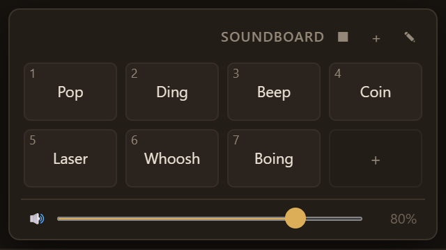
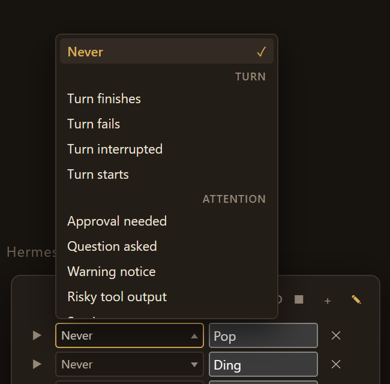
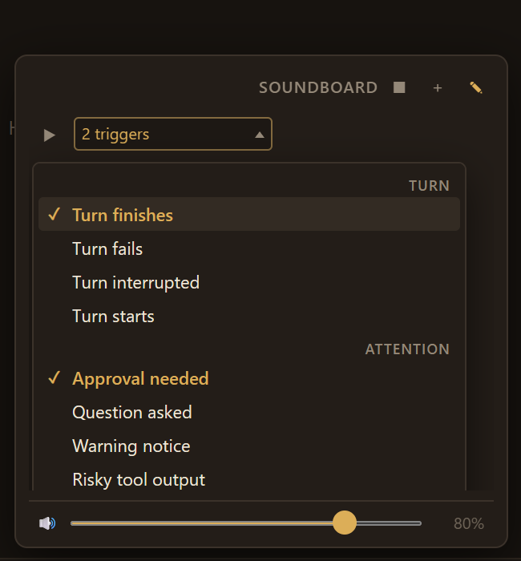
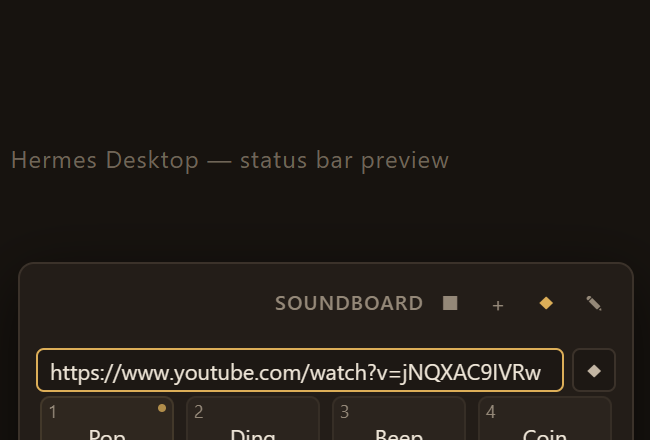
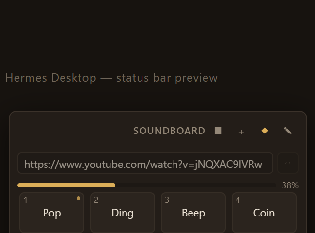
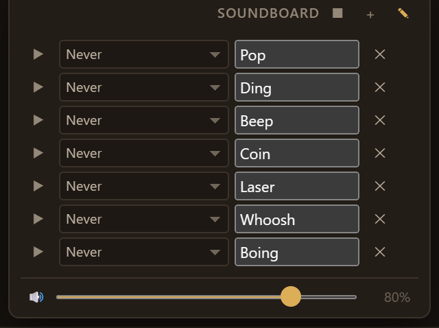
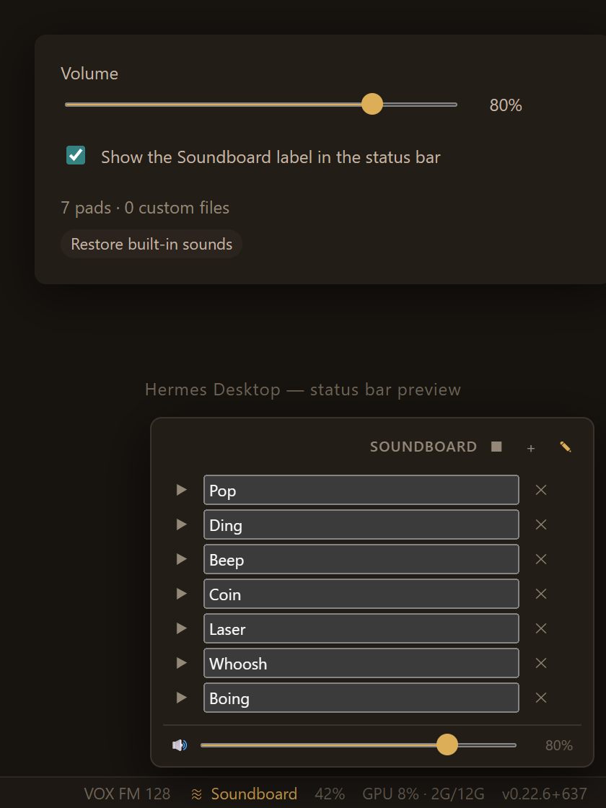

# hermes-soundboard

A soundboard for the **Hermes Desktop** app, docked in the bottom bar.

Click the chip at the right end of the status bar and a popover of pads opens
above it: seven built-in cues synthesized with WebAudio (no assets, no
network), plus any audio files you add. Names, order, volume and a "manage"
mode all persist per machine.

```
┌──────────────────────────────────────────────────┐
│  … status bar …              ≋ Soundboard  42%  │  ← chip
└──────────────────────────────────────────────────┘
                       ▲
        ┌──────────────────────────────┐
        │ SOUNDBOARD           ■  +  ✎ │
        │ ┌────┐ ┌────┐ ┌────┐ ┌────┐  │
        │ │1Pop│ │2Dng│ │3Bep│ │4Con│  │  ← 1–9 = keys
        │ └────┘ └────┘ └────┘ └────┘  │
        │ ┌────┐ ┌────┐ ┌────┐ ┌────┐  │
        │ │5Lsr│ │6Whs│ │7Bng│ │ +  │  │  ← + adds a file
        │ └────┘ └────┘ └────┘ └────┘  │
        │ ──────────────────────────── │
        │ 🔊 ▬▬▬▬▬▬▬▬▬▬▬▬▬▬▬▬   80% │
        └──────────────────────────────┘
```

## What it does

- **Bottom-bar controls.** The whole soundboard is a status-bar chip and a
  popover — no pane, no page, no window to manage.
- **Built-in sounds.** Pop, Ding, Beep, Coin, Laser, Whoosh, Boing. Each is a
  handful of oscillator/noise nodes with an exponential envelope, so they are
  instant and cost nothing on disk. Delete them and they can be restored from
  the manage list or the settings page.
- **Custom sounds.** `+` opens a file picker (`audio/*`, multi-select), or drop
  audio files straight onto the panel. Each file is copied into the plugin's
  private data folder as base64 and read back into a `data:` URL on first play,
  so a custom pad survives restarts without the original file staying put.
- **YouTube import.** The link button takes a YouTube URL (or a bare video id)
  and adds it as an mp3 pad, through `yt-dlp` + `ffmpeg`. See
  [YouTube import](#youtube-import).
- **Manage mode.** The pencil button lists every pad with a preview button, a
  **"play when" trigger dropdown**, an inline rename field (Enter or blur
  commits, Escape reverts) and delete. Deleting a custom pad also trashes its
  stored clip.
- **Triggers — the board plays itself.** Any pad can be bound to a live Hermes
  event, so it fires on its own: the turn finishing (split by success / failure
  / interruption), an approval or a question that has the agent blocked, a
  warning notice, risky tool output, a session error, a subagent finishing,
  context compaction, a heartbeat, a wake phrase, or affection detected in your
  message. Bound pads carry a dot in the grid; the panel footer names the last
  trigger that actually fired. See [Triggers](#triggers).
- **Volume + mute.** One master volume, persisted. `■` stops everything and
  suspends the audio context.
- **Keyboard.** While the panel is focused, `1`–`9` fire the first nine pads and
  `Escape` closes it.
- **⌘K command.** "Open Soundboard" from the command palette.
- **Settings → Plugins → Soundboard.** Volume, whether the status-bar chip
  shows its label, and how many pads fit per row.

## YouTube import

Paste a link, get a pad. The link button in the panel header opens a one-field
row; Enter or the arrow button starts the conversion, and the pad appears when
it finishes — typically a few seconds for a short clip.

- **An open chat is required.** `shell.exec` is session-bound: the gateway runs
  the command in the focused chat's cwd under that session's policy, and refuses
  with `invalid_params` if the call names no live session. So the import needs a
  chat open, and says so plainly instead of surfacing that code.
- **What it needs.** `yt-dlp` and `ffmpeg`. yt-dlp is fetched on demand by
  `uvx`, which ships with Hermes, so in practice only **ffmpeg** has to be on
  `PATH`. Both are probed before the field is offered, and a missing one is
  named in the error rather than failing silently.
- **30-second cap.** A soundboard cue wants seconds, not a track. The duration
  is checked before downloading anything; a longer video is refused with its
  length in the message.
- **3 MB cap** still applies (base64 in `ctx.files` doubles nothing, but
  inflates by 4/3 against a 4 MiB text limit).

### Why the job is a detached script

The only process door a plugin has is `host.request('shell.exec')`, and it kills
its child at 30 seconds. A conversion can take longer, so the plugin writes a
`.cmd` script into its own data folder, launches it detached, and watches a
status file. Three details are load-bearing and each was a real failure first:

| Detail | Why |
|---|---|
| Every path is **relative**, anchored by `%~dp0` | Batch needs `%%` for a literal `%`, so an env-var path like `%APPDATA%` written through the same escaper became the literal text `%%APPDATA%%` — the script could not `cd`, exited 0, and wrote **no status file**, so the plugin waited out its whole budget on a job that had already died |
| The script takes **no arguments** | `start /b cmd /c "script.cmd" "arg"` silently drops arguments — four forms were probed, all arrived empty. Every path is baked into the script instead |
| `%` is **doubled** | `-o out.%(ext)s` — an unescaped `%` makes cmd refuse to parse the whole file (`File Not Found`), running no line at all |
| Duration is probed **in the foreground** | `--match-filter "duration <= 30"` puts `<`/`>` in the command, which cmd eats as redirection even inside quotes; yt-dlp then reports "You must provide at least one URL" |

The status file is the only channel back — `shell.exec` captures output at
launch and the child is gone by then — so the job writes `ok`/`fail` when it
finishes, and the plugin polls it. Because a status file only appears at the
END, the plugin also reads yt-dlp's log as the job runs and turns its
`[download] 42.3%` lines into the progress bar. Every failure path raises a host
toast as well as the inline note, since the panel is often shut by then.

## Triggers

A binding is `pad → triggers`, plural. The picker is grouped and **multi-select**:
each click toggles one trigger and leaves the menu open, so a single pad can
answer to a whole family of events — one sound for "the agent needs me", bound
to approvals, questions and warnings alike. With nothing bound the control reads
*Never*; with one binding it names that trigger; with several it reads *3
triggers* and a tooltip lists them all. *Clear all triggers* empties the list.

Each entry maps to one real gateway event with a filter, so a pad reacts to "the
turn finished successfully", not "every `message.complete` frame".

Stored shape is `triggers: ["turn.complete", …]`. A save written by an earlier
version holds a single `trigger: "id"` string; it is migrated to a one-entry list
on load, and unknown or duplicate ids are dropped.

| Group | Trigger | Underlying event | Fires when |
|---|---|---|---|
| Turn | Turn finishes | `message.complete` | status is not `error` / `interrupted` |
| Turn | Turn fails | `message.complete` | status `error`, or `error` is set |
| Turn | Turn interrupted | `message.complete` | status `interrupted` |
| Turn | Turn starts | `message.start` | you sent a message (not an auto-continue) |
| Attention | Approval needed | `approval.request` | the agent is blocked on approval |
| Attention | Question asked | `clarify.request` | the agent is blocked on a question |
| Attention | Warning notice | `notification.show` | level `warn` or `error` |
| Attention | Risky tool output | `tool.output_risk` | injection / secret findings |
| Attention | Session error | `error` | failure outside a turn |
| Work | Subagent finishes | `subagent.complete` | a delegated child is done |
| Work | Context compacted | `status.update` | kind `compacted` |
| Ambient | Heartbeat fires | `status.update` | kind `heartbeat` |
| Ambient | Wake phrase | `wake.detected` | your wake phrase fired |
| Ambient | Affection detected | `reaction` | "good bot", "ily", a heart |

Only the events the table names are subscribed — one listener per event, shared
by every pad bound to it. A binding is validated on read, so a stale id in
storage degrades to "never" instead of throwing.

Hermes emits 88 named events in total (78 backend + 10 client-local); this
plugin deliberately exposes the 14 that are worth interrupting a human for. The
full set is the generated `GATEWAY_EVENT_TYPES` in
`apps/shared/src/gateway-contract.generated.ts`.

**Why the picker is not a `<select>`.** It was one, and the list came up as a
near-white sheet under this theme's cream text — roughly 1.1:1, unreadable. A
native option list is not a DOM node: the browser draws it from the page's
`color-scheme`, so no page CSS can restyle it. The picker is now a button plus
an in-DOM list, so every pixel of the menu is ours and it inherits the theme.
Rows assert at **8.12:1** and group headers at **4.80:1**.

**Why the menu is in flow, not positioned.** Three attempts, three failures, and
the last two were only visible in the real app:

| Approach | What happened |
|---|---|
| `position: absolute` | Clipped by the manage list's `overflow-y: auto` |
| `position: fixed` | Anchored to the *popover*, not the viewport — `PopoverContent` carries `backdrop-blur-md`, and a backdrop-filter makes that element the containing block for fixed descendants. The menu rendered far off-screen; the picker looked dead |
| in flow (`flex: 0 0 100%` on a wrapping row) | Correct |

The wrapper carries `display: contents` so the picker and menu become direct
children of the row's flex layout; the menu then wraps onto its own full-width
line beneath the row. Nothing to clip, nothing to re-anchor.

That lesson is now enforced by the harness: the stub popover mirrors the real
one's `backdrop-filter`, and the suite asserts the menu is inside the panel box
and at least 200px wide. Both assertions were verified to fail on a
deliberately reverted build.

**On autoplay.** A triggered sound plays while the window may be unfocused, so
the WebAudio context can be suspended by the browser's autoplay policy. Every
trigger attempts a resume; if the platform refuses, the pad still lights up, so
the cue is never silently lost.

## Screenshots











| | |
|---|---|
|  |  |
| Manage mode — rename, preview, delete | Settings → Plugins → Soundboard |

All of these are produced by `npm run test:ui`, not by hand.

## Install

Hermes Desktop loads plugins from `$HERMES_HOME/desktop-plugins/<id>/plugin.js`
and the folder name must equal the plugin `id` (`hermes-soundboard`).

```bash
git clone https://github.com/SztejnMaxer7cm/hermes-soundboard.git
cp -r hermes-soundboard ~/.hermes/desktop-plugins/hermes-soundboard
```

On Windows that is typically:

```powershell
git clone https://github.com/SztejnMaxer7cm/hermes-soundboard.git
xcopy /E /I hermes-soundboard "%LOCALAPPDATA%\hermes\desktop-plugins\hermes-soundboard"
```

Or just copy `plugin.js` into that folder — it is the whole plugin. Then run
**Reload desktop plugins** from ⌘K (the app also hot-reloads every save of the
file). The plugin is enabled by default; it stays off if you toggle it off in
**Capabilities → Plugins**.

## Limits, on purpose

- 40 sounds maximum, 3 MB per audio file. `ctx.files` refuses text beyond 4 MiB
  and base64 inflates by 4/3, so 3 MB is the largest clip that reliably fits.
- Soundboard clips are meant to be short. Anything long belongs in a player, not
  a pad.

## How it is built

One plain-ESM file, no build step, no dependencies — the two things the Desktop
loader resolves at runtime are `@hermes/plugin-sdk` and `react/jsx-runtime`:

| Surface | API |
|---|---|
| Bottom bar | `ctx.register({ area: STATUSBAR_AREAS.right })` + `Popover` |
| Command palette | `ctx.register({ area: PALETTE_AREA })` |
| Settings page | `ctx.registerSettingsPage({...})` |
| Persistence | `ctx.storage` (sounds + settings) |
| Clips | `ctx.files.writeText('data', '<id>.b64', base64)` / `readText` / `trash` |
| Sound | WebAudio (`OscillatorNode`, `AudioBufferSourceNode`) and `Audio` |
| Text | `ctx.i18n.register({ en, pl })` + `usePluginI18n` |

Custom clips are stored base64 rather than as binary because `ctx.files` is the
only file door a plugin gets, and it is text (plus `readDataUrl`) oriented. No
`window.hermesDesktop` calls, no DOM reach into the app, no hardcoded colours —
all of it is theme variables, so the pads follow whatever skin is active.

Everything read back out of storage is rebuilt field by field before use, so a
hand-edited or half-written JSON blob degrades to the built-ins instead of
throwing inside a render.

## Test

Three suites, all runnable with `npm test`:

```bash
npm test            # all three
npm run test:unit   # jsdom harness, 38 assertions
npm run test:picker # real file picker in Chromium, 8 assertions
npm run test:ui     # render + geometry + a fired trigger in Chromium
```

**`test/harness.mjs`** bundles
for a stub with the same shapes, mounts every contribution in jsdom and drives
them the way a user would — click a pad, press a number key, add a file, drop a
file, refuse an oversized one, rename, delete, stop-all, Escape, then reload the
plugin and corrupt the stored JSON, then bind pads to gateway events and emit
real ones to prove only the right pad fires. 38 assertions.

**`test/picker.mjs`** drives a **real** `<input type="file">` with real `File`
objects in Chromium: one mp3, the same mp3 twice, two at once, a 4 MB file, a
`.txt`, then delete. 8 assertions.

It exists because the jsdom harness could not have caught the bug it now guards.
`input.files` is a **live `FileList`**: the plugin resets `input.value` after a
pick (otherwise the same file cannot be chosen twice), and that reset empties
`input.files`. Reading `event.target.files` straight into a variable therefore
handed `addFile` an empty list, every time — the picker appeared to do nothing at
all. jsdom let the harness assign `files` as a plain static property, so the
suite passed while the shipped plugin was broken. The suite was confirmed to
fail (5 checks, 4 failures) against the unfixed code before the fix was restored.

**`test/preview.mjs`** renders the same plugin in a real Chromium against the
app's theme variables and measures the result: pad count, grid columns, and
whether the header, grid and volume row share one left and one right edge. It
writes `preview-statusbar.png`, `preview-panel.png`, `preview-manage.png` and
`preview-settings.png` to `.build/`. That is what catches a layout that reads
fine in code and wrong on screen — the padding asymmetry and the orphaned grid
cell in this plugin were both found that way, not by reading the CSS.

All three borrow `esbuild`, `jsdom`, `react`, `react-dom` and `playwright-core`
from an installed Hermes (`HERMES_DEPS_ROOT` points elsewhere if needed),
precisely because the plugin itself declares no dependencies and this repository
has no `node_modules`.

Passing these proves the plugin evaluates, registers, renders, persists, lays
out, and handles a real file pick. They do not replace looking at it: a status
bar chip is 15 CSS px tall, and the final judgement of a popover is still the
eye.

## License

MIT
